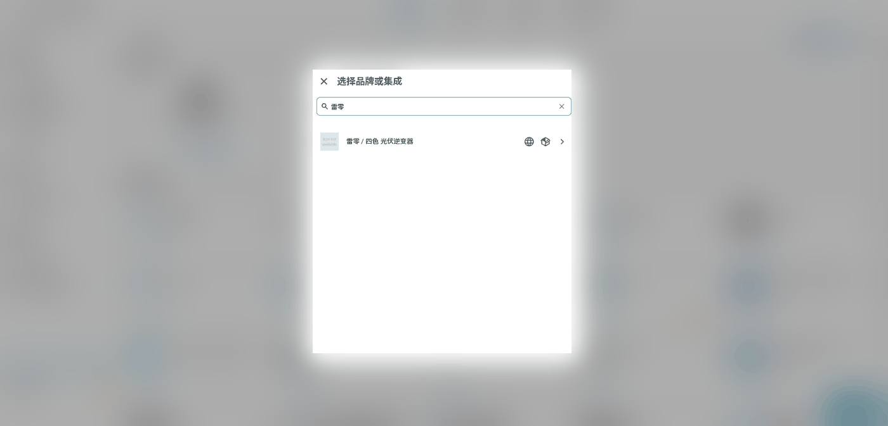
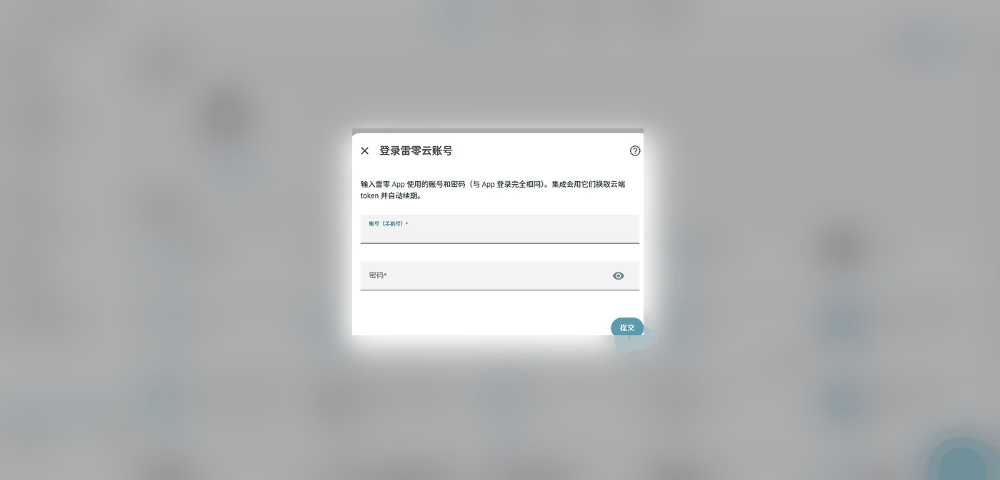
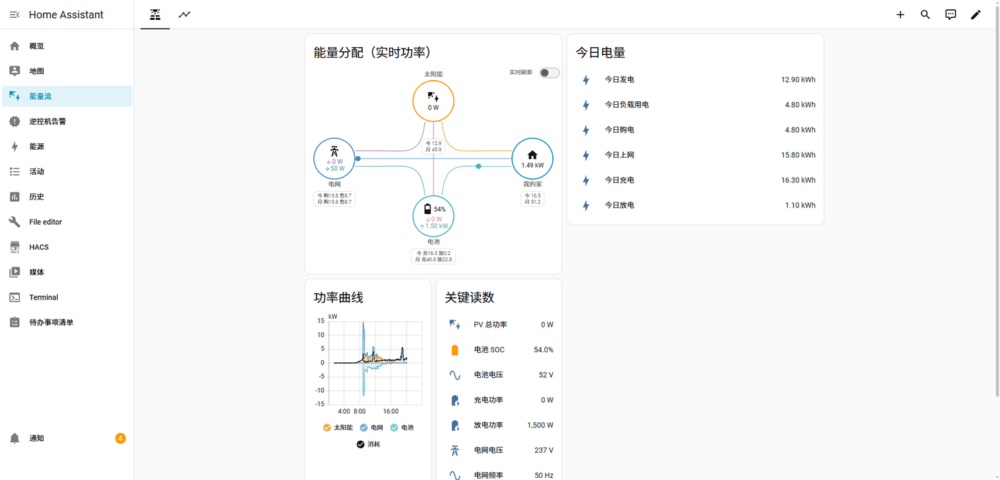
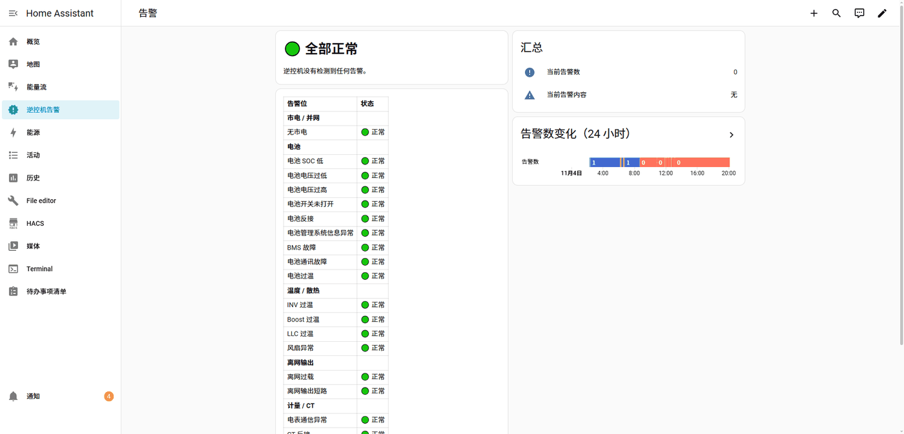

# ha-siseli-solar

[](https://my.home-assistant.io/redirect/hacs_repository/?owner=lclGithub&repository=ha-siseli-solar&category=integration)

把 **雷零 LABCT12KW 逆控一体机**（以及采用同一套「四色 / siseli」云平台的其它光伏、储能设备）的数据接入 Home Assistant。

登录界面直接输入雷零 App 的账号密码，集成会自动发现设备并生成 61 个设备字段实体、12 个云端电量汇总实体和 2 个告警总览实体（含 22 个告警位与 1 个开关，共 98 个实体）。

> [!WARNING]
> **非官方项目，与厂家无关。** 本项目为个人开发，与雷零科技 / 四色云（Urayzero）没有任何
> 隶属、合作或授权关系。集成通过逆向 App 客户端得到的私有云端接口取数，**不是官方 API**，
> 可能随时被厂家改动、限流或封禁。
>
> **仅供个人学习与技术研究**，请勿用于商业用途或关键生产场景；请保持低频轮询。
> 因使用本项目造成的账号受限、设备异常、数据丢失、服务条款违约或任何其他损失，
> 均由使用者自行承担，作者不提供任何明示或暗示的担保。详见
> [许可与免责声明](#许可与免责声明)。

---

## 界面预览

| 添加集成时搜索「雷零」 | 在 HA 里登录雷零云账号 |
|---|---|
|  |  |

| 能量流看板（安装后自动创建） | 逆控机告警面板 |
|---|---|
|  |  |

> 截图来自实际运行的 Home Assistant，账号与用户名已遮挡。

## 功能

- **配置流程登录**：账号 + 密码，自动换取 token，并自动续期（access 2 小时 / refresh 30 天）
- **自动发现设备**：账号下有多台设备时可以选具体哪一台
- **61 个精选实体 + 12 个云端电量汇总**：PV、电池、电网、负载、温度、电量统计、设备信息
- **22 个关键告警位**：云端 138 个故障/保护位里挑出常用项，做成 `binary_sensor`
- **实时刷新开关**：一键把设备上报周期压到 3 秒（详见下文）
- **离线容错**：设备离线时保留上一帧数值并把实体标为不可用，而不是让集成报错
- **重新认证**：token 彻底失效时 HA 会提示重新输入密码
- **可调轮询间隔**：默认 60 秒，范围 30–600 秒

## 安装

### 方式一：HACS / Marketplace（推荐）

1. 打开 HACS（Home Assistant 2026.11 起为 **设置 → Marketplace**）→ 右上角 ⋮ → **自定义存储库**
2. 仓库地址填 `https://github.com/lclGithub/ha-siseli-solar`，类别选 **集成**
3. 搜索「雷零 / 四色」安装，重启 Home Assistant

### 方式二：手动拷贝

把 `custom_components/siseli_solar/` **整个目录**复制到 HA 配置目录下的 `custom_components/`。
不要只挑 `.py` 文件——`frontend/`、`translations/`、`brand/` 也必须一起带上，否则自定义卡片和图标会缺失。

重启 Home Assistant。

### 方式三：让 AI 帮你装

把 [docs/AI-INSTALL.md](docs/AI-INSTALL.md) 里的提示词整段复制给能操作文件或终端的 AI
（Claude Code、Cursor、Codex 等），它会自己完成下载、校验、安装和日志检查。
提示词刻意不索取 HA 令牌和雷零账号密码——登录只在 HA 网页里做。

## 配置

**设置 → 设备与服务 → 添加集成 → 搜索「雷零」**

1. 输入雷零 App 的账号（手机号）和密码
2. 如果账号下有多台设备，选择要接入的那一台
3. 完成，设备卡片和这些实体就出现了

轮询间隔可以在集成卡片的「配置」里改。

## 实体清单

| 分类 | 实体 |
|---|---|
| PV | PV1/PV2 电压、电流、功率，PV 总功率，光伏功率(统计)，PV 今日/累计发电量 |
| 电池 | SOC、SOH、电压、电流、温度、充电功率、放电功率、充放电功率、电池类型 |
| 电网 | 电网电压、电流、频率、功率因数、取电功率(R/总)、馈网功率(R/总)、电网功率 |
| 负载 | 负载功率(统计)、网侧负载功率、单机负载总功率、离网负载功率、离网输出电压/电流 |
| 温度/运行 | 逆变器温度、IPM 温度、LLC 温度、运行状态、风扇转速 |
| 电量统计 | 今日/累计负载用电、充电量、放电量、上网电量、购电量、自用电量 |
| 诊断（默认隐藏） | BMS 限流、累计运行时长、主故障码、警告子码、CT 模式、ARM/DSP 版本、Modbus 版本、额定功率 |

共 61 个，其中 10 个是诊断类，默认不在概览里显示（可在实体设置里手动启用）。

另外还有一个开关实体 **`switch.xxx_shi_shi_shua_xin`（实时刷新）**。

## 告警位（默认 22 个，完整 138 个可选）

云端 category=2 一共定义了 **138 个**故障/保护位。全部铺开会很吵，所以默认只创建
**22 个真正需要日常盯的**（`device_class: problem`，`on` = 正在告警）：

| 分组 | 告警位 |
|---|---|
| 市电/并网 | 无市电 |
| 电池 | SOC 低、电压过低、电压过高、开关未打开、电池反接、BMS 信息异常、BMS 故障、通讯故障、电池过温 |
| 温度/散热 | INV 过温、Boost 过温、LLC 过温、风扇异常 |
| 离网输出 | 离网过载、输出短路 |
| 计量/CT | 电表通信异常、CT 反接 |
| PV 安全 | PV 电压过高、面板绝缘阻抗过低、GFCI 过高 |
| 控制板 | EEPROM 读写异常 |

**想要全部 138 个**：集成卡片 → 配置 → 勾选「显示全部告警位」，保存后会重新创建。

数据来源是 `state/latest` 里的 `firingAlarms`：**只有正在触发的告警才会出现**，
「不在列表里」就是正常。每条告警带这些属性：

- `触发时间`、`触发值`、`等级`、`设备内告警码`
- `英文名`、`说明`

另有两条总览实体：

| 实体 | 说明 |
|---|---|
| `sensor.xxx_dang_qian_gao_jing_shu`（当前告警数） | 数字，属性里带告警名称列表 |
| `sensor.xxx_dang_qian_gao_jing`（当前告警） | 文本，如「无市电」；属性里是完整详情 |

安装后会自动出现一个独立看板 **左侧边栏 →「逆控机告警」**，带 🔴/🟢 红绿灯表格、汇总和 24 小时告警数曲线，无需手工配置。

自动化示例：

```yaml
trigger:
  - platform: state
    entity_id: binary_sensor.12kwni_kong_ji_wu_shi_dian
    to: "on"
    for: "00:02:00"
action:
  - service: notify.mobile_app
    data:
      message: "逆控机无市电已持续 2 分钟"
```

## 实时刷新（速报）

默认轮询 60 秒。打开「实时刷新」开关后：

| 项目 | 变化 |
|---|---|
| 设备上报周期 | 约 60 秒 → **3 秒** |
| HA 轮询间隔 | 60 秒 → **5 秒** |
| 有效期 | 云端 180 秒自动失效，集成**每 60 秒自动续订** |
| 安全阀 | 最长开 **30 分钟**，到点自动关闭 |

它走的是 App「实时能流」页面用的同一套接口
（`/remote/device/state/report/fast/{supported,start,stop}`）。

两个坑（已处理）：

- `scene` 必须传**枚举码 `1`**。swagger 写的是 `enum: ["DEVICE_LIVE_ENERGY_FLOW"]`，
  但服务端按 code 反序列化，传名字会报 `20101 invalid format`。
- `clientID` 必须匹配 `^user_\d+_[A-Za-z0-9]{6}$`，集成用 entry_id 的哈希生成，
  重启后仍是同一个，可以把上次遗留的速报关掉。

**什么时候用**：想看功率曲线细节、排查异常、或做短时自动化时开一下。
平时不要常开——会增加 DTU 上行流量和云端压力，而且设备忙时会频繁返回
`70001 Device is busy`（集成已把这种情况当作瞬时状态处理，不会让实体变不可用）。

## 能量流看板（自动创建）

集成加载时会自动做两件事，**失败只记日志，不影响实体**：

1. **写入能量配置**（`energy` 集成）：把 PV 累计发电、累计购电/上网、累计充/放电
   追加成 `solar` / `grid` / `battery` 三个源。**只追加不覆盖**——已经配过的计量点
   会跳过，不会动你原有的能量配置。
   电网和电池用的是官方的「双传感器」模式
   （`power_config.stat_rate_from` / `stat_rate_to`），HA 会自己算出带符号的净功率。
2. **创建「能量流」看板**，侧边栏直接出现，两个页签：
   - 实时：`power-sankey` 功率流向图 + 功率曲线 + 关键读数 + 今日电量
   - 电量统计：能量分布、发电/用电曲线、数据源明细、累计电量

实体 ID 是通过实体注册表按 `{deviceId}_{key}` 反查的，没有硬编码，
所以改设备名也不会失效。

### 自定义卡片：复刻原生「能量分配」，但标实时功率

「实时」页第一张卡是集成自带的卡片 `custom:siseli-power-flow`。
**直接照着 HA 前端源码 `hui-energy-distribution-card.ts` 移植的**，不是凭印象画的：

- 同一套 DOM 结构（三行 `row` + `.lines` 绝对定位的 SVG 连线层）
- 同一套 CSS（圆 80×80、`.label` 高 20px、`.spacer` 84px、`vector-effect: non-scaling-stroke`）
- 同一组 SVG 路径 `d`（`solar` / `return` / `battery-house` / `battery-grid` / `battery-solar` / `grid`）
- 同样的流动小圆点：沿 `getPointAtLength` 采样，用 Web Animations 驱动
- 图标用 `ha-icon` + 同款 MDI（原生用 `ha-svg-icon` + `@mdi/js` 的 path，图形一致）

唯一区别：数值来自**实时功率实体（W）**，不是统计 kWh。

| 节点 | 显示内容 |
|---|---|
| 太阳能 | 当前发电功率 |
| 电网 | `←` 馈网 / `→` 取电（两个方向同时显示） |
| 电池 | `↓` 充电 / `↑` 放电，圆内带 SOC 与电量格数图标 |
| 我的家 | 当前负载功率 |

卡片右上角还有「实时刷新」开关（和侧边栏那个 `switch` 是同一个实体，
点它等于调 `switch.turn_on/turn_off`）。每个圆圈下方挂一块统计小卡，
显示该节点的**今日 / 本月**电量（单位 kWh）：

| 节点 | 统计块内容 |
|---|---|
| 太阳能 | 今 发电 / 月 发电 |
| 电网 | 今 购电·售电 / 月 购电·售电 |
| 电池 | 今 充电·放电 / 月 充电·放电 |
| 我的家 | 今 用电 / 月 用电 |

统计块是**绝对定位**的（`position:absolute; top:100%`），不改变行的宽度，
所以不会打乱原生那套连线层的对齐。

数据**全部来自云端**，不是本地算的。集成调用
`/deviceOverView/stateAttributeSummary/category/monthly`（分类＝光伏逆变器电量类），
一次请求返回**整月按天**的数据，同时得出：

- `today` = 当天那一个点（云端口径的今日值）
- `total` = 本月至今合计（只累加 `isRealValue=true` 的点）

这 12 个值落成 12 个实体（`云端今日/本月 + 发电量 / 购电量 / 售电量 / 充电量 /
放电量 / 用电量`），每 10 分钟刷新一次（`MONTH_ENERGY_INTERVAL`）。

⚠️ 这组「购电量 / 售电量」比设备自带的「今日购电 / 今日上网」准确。
后者只统计进负载的那部分、还会倒退（实测今日购电显示 0.1 kWh，云端汇总是 10.3 kWh）。
两者都保留，需要哪个用哪个。

配置文件在 `custom_components/siseli_solar/frontend/siseli-power-flow.js`，
零依赖（原生 Web Component + SVG，不用 lit、不用 CDN）。注册方式：

1. `card_frontend.py` 把 `frontend/` 挂到静态路径 `/siseli_solar_frontend`
2. 往 Lovelace resources 登记一条 `module` 资源

**改了这个 JS 之后不用手工改版本号**：`card_frontend.py` 用文件内容的哈希生成资源
URL（`?v=<hash>`），JS 一变 URL 就变，重启 HA 后浏览器不会继续吃旧缓存。

卡片配置项：

```yaml
type: custom:siseli-power-flow
title: 实时功率流
pv: sensor.xxx               # PV 总功率
grid_import: sensor.xxx      # 电网取电总功率
grid_export: sensor.xxx      # 馈入电网总功率
battery_charge: sensor.xxx
battery_discharge: sensor.xxx
load: sensor.xxx             # 单机负载总功率
soc: sensor.xxx              # 可选，电池 SOC
```

为什么不用官方的 `energy-distribution` 做这件事：它的配置项只有
`link_dashboard`，结构上只能读能量配置里的 kWh 计量表，没有功率模式。
官方的 `power-sankey` 是实时功率，但 2026.5 的前端不渲染节点数值
（`show_values` 是 dev 分支才有的选项，实测无效）。

### 「电量统计」页为什么一小时才动一次

那一页的卡片（`energy-distribution` / `energy-*-graph` / `energy-sources-table`）
画的是 **累计电量（kWh），不是功率（W）**，数据来自 recorder 的**长期统计**，
而长期统计的当前小时要等**整点过后才落盘**。所以它在一小时内看起来是静止的，
整点会整体跳一次——实测 09:48 显示 1.4 kWh，10:01 跳到 3.7 kWh。

需要分钟级实时请看**「实时」页**：那里的 `power-sankey` 和 `功率曲线` 用的是
`energy_dashboard_now` 集合，走瞬时功率，每 `scan_interval` 秒更新一次。

所有能量卡片都必须带 `collection_key`，否则不会加入共享的能量集合、
也拿不到日期选择器。缺了它卡片只会渲染一次快照。

另外云端有个数据 bug：**「今日购电」实体会和「累计购电」对不上**
（实测累计 +13.1 kWh，而日计数只有 0.8 kWh，还会倒退）。
以累计计量表为准，卡片显示的数字是对的。

### 两个需要知道的细节

- HA 至今**没有**「集成注册 Lovelace 看板」的公开 API。看板条目是集成在
  `hass.data["lovelace"].dashboards` 里注入 + 注册 frontend 面板 + 写
  `lovelace_dashboards` 存储实现的（内部接口，已做异常兜底）。
- 因此这个看板**不在** `lovelace_dashboards` 集合的运行时缓存里，
  在「设置 → 仪表盘」里能看到，但点删除会报找不到条目。
  真要删，只能删集成或改 `.storage/lovelace_dashboards`。

## 已知限制

- **只读**：这一版不做写入。云端其实还暴露了 46 个可写设置项（含电池充放电参数、开关机），后续可以扩展成 `number` / `select` / `switch`。
- **设备离线**：`state/latest` 会返回 `71000 Device is offline`，此时实体保持上一帧数值并标记不可用。
- **依赖云**：模块断网时 App 都看不到数据，集成同样拿不到。想本地直连需要 RS485 协议文档，厂家没公开。
- **账号密码存在配置条目里**：HA 的 `.storage` 是明文，和大多数云集成一样。介意的话建议单独建一个账号。

## 原理

签名算法完整复刻自门户前端 `umi.js` 的请求拦截器：

```
参数 = sortKeys({IOT-Open-AppID, IOT-Open-Body-Hash, IOT-Open-Nonce})
消息 = Base64("k=v&k=v")
密钥 = AES128CBC_Decrypt(openAppSecret, md5hex(appId)[0:16], md5hex(appId)[16:32])
签名 = md5( HMAC-SHA256(消息, 密钥) )        # md5 吃原始 digest
```

`IOT-Open-Body-Hash = sha256hex(请求体原文)`，参与签名但不作为请求头发送。

## 兼容性

- Home Assistant **2024.12** 及以上（用到了 `entry.runtime_data`、`StaticPathConfig`
  以及无参构造的 `OptionsFlow`；低于这个版本「配置」按钮会报错）
- 无第三方 Python 依赖（只用 `aiohttp`、`hashlib`、`hmac`）

## 许可与免责声明

代码以 [MIT](LICENSE) 许可发布，按「现状」提供，不附带任何担保。

- **非官方**：本项目与雷零科技 / 四色云（Urayzero）无隶属、合作或授权关系，也未获官方
  认可；文中出现的产品名、商标归各自所有者，仅用于说明兼容性。
- **接口风险**：签名算法和接口来自 App / 门户前端逆向，厂家改动后集成可能随时失效，
  作者没有义务也没有能力保证持续可用。
- **账号与数据风险**：账号密码以明文保存在 HA 的 `.storage` 中，与多数云集成一致；
  请自行评估风险，建议使用独立账号并控制轮询频率。
- **使用范围**：仅供个人学习与技术研究，请勿用于商业用途或关键生产场景；由此产生的
  账号受限、设备异常、数据丢失或服务条款问题由使用者自行承担。
- **安全**：如何报告漏洞、哪些数据会被接触，见 [SECURITY.md](SECURITY.md)。

